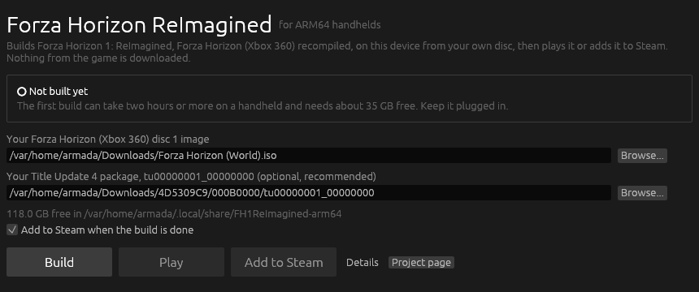
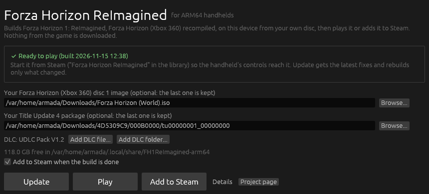

# fh1-reimagined-arm64

Play [Forza Horizon 1: ReImagined](https://github.com/FH1-ReImagined/ForzaHorizon1-ReImagined),
the recompiled Xbox 360 *Forza Horizon* with its online play brought back,
natively on Snapdragon handhelds running [ArmadaOS](https://armadaos.dev/), such
as the Retroid Pocket 6.

  
  

Upstream ships a Windows installer and x86-64 Linux packages, and its ARM64
Linux build has never been played. This repository makes it a native
linux-arm64 game compiled on the handheld itself, started from Steam, with no
emulation of the CPU.

> **Work in progress.** By default the game draws as upstream does, on its
> emulated Xbox 360 GPU, which is slow on a handheld (22-30 fps on the RP6).
> The native Vulkan renderer that [fh2-recompiled-arm64](https://github.com/Ken5998/fh2-recompiled-arm64)
> uses for Forza Horizon 2 (30 fps on the RP6) is now built in too, adapted
> to Forza Horizon: it is experimental and off unless you turn it on (see
> [Native renderer](#native-renderer-experimental)).

## Install

You need your own **Forza Horizon for Xbox 360**: disc 1 as an ISO and,
recommended, its **Title Update 4** package (`tu00000001_00000000`, or a zip
holding it). Horizon Rally, the 1000 Club and most online players need TU4.
Keep about 35 GB free.

1. In **Desktop Mode**, download `FH1ReImagined-Launcher-linux-arm64.tar.gz`
   from the [latest release](https://github.com/Ken5998/fh1-reimagined-arm64/releases/latest),
   extract it to your home folder and start `FH1ReImagined/fh1-launcher`.
2. Pick the disc image and the title update (the launcher looks in Downloads,
   ROM folders and SD cards) and press **Build**. Keep the handheld on its
   charger: the first build compiles the SDK and the whole recompiled game
   and takes a couple of hours.
3. Press **Play**, or start **Forza Horizon ReImagined** from Steam: the
   handheld's controls reach the game only when Steam starts it. The launcher
   adds the shortcut without artwork; pick yours with SteamGridDB.

ReImagined reads the game from a folder, so the build extracts the disc once
(about 8 GB, in `~/.local/share/FH1ReImagined-arm64/files`) and applies the
update next to it; after that the ISO isn't needed. **Update** in the
launcher pulls this repository's fixes and rebuilds only what they touch.

## DLC

**Add DLC file** and **Add DLC folder** in the launcher install DLC where the
game finds it, once the game is built: your own Microsoft car packs (the
packages, a zip of them or a Xenia content folder) and community packs such as
the [UDLC Pack](https://www.moddb.com/mods/forza-horizon-udlc-pack/downloads/udlcv12)
(the Forza Horizon 2 and Fast & Furious cars) and its
[Traffic Car Unlocker](https://www.moddb.com/mods/forza-horizon-udlc-pack/downloads/udlc-traffic-car-unlocker).
Pick the zip as downloaded. Close the game first; it has the new cars the next
time it starts. The same from a terminal:

    python3 ~/.local/share/FH1ReImagined-arm64/overlay/scripts/install-dlc.py ~/Downloads/UDLCv1.2.zip

It uses ReImagined's own installer, which unlocks every package. Pinyon
Shift's players
found that painting the 2015 Dodge Charger F&F or the 2014 Maserati Ghibli F&F
from the UDLC Pack hangs the paint shop. Keep a copy of
`~/.local/share/FH1ReImagined-arm64/user` before removing a pack: a save can
own cars that are gone.

## Settings

`~/.local/share/FH1ReImagined-arm64/game/forza.toml` holds the settings, with
the same keys ReImagined's own launcher writes. The RP6 defaults follow
upstream's Steam Deck advice: 30 fps (the game's own rate), the 3D scene at
960x540, scene MSAA off and AMD FSR 1 to scale it to the screen.

The game plays offline until you uncomment `live_server` in that file, which
points it at ReImagined's public Forza Live server (Horizon World free roam,
leaderboards, Rivals, clubs). Your online identity is
`~/.local/share/forza/4D5309C9/live_identity.txt`: keep a copy.

Saves and the log (`forza.log`) are in
`~/.local/share/FH1ReImagined-arm64/user`.

If MangoHud or the Steam overlay flicker, the launcher can turn GPU
preemption off (kernel option `msm.enable_preemption=0`, then restart).

## Native renderer (experimental)

FH2 Recompiled's native renderer reads the game's GPU commands and draws them
with Vulkan, with the game's shaders translated ahead of time, instead of
emulating the Xbox 360 GPU. Forza Horizon 2 runs on the same engine, so it is
built into this game too, off by default. Each build also makes its shader
library from your game files, title update and DLC
(`~/.local/share/FH1ReImagined-arm64/game/fh1_shaders.nfsp`).

To try it, set the game's launch options in Steam (Properties > Shortcut) to

    FH1_RENDERER=native %command%

and remove them to go back to the emulated GPU. While you play, the shaders
the library lacks are written to `~/.local/share/FH1ReImagined-arm64/shader-dump`;
press **Update** in the launcher afterwards and the next build adds them.
`forza.log` tells how it went (the lines with `[nativo]` and `[fh1 nativo]`),
and `renderer.txt` beside it which renderer the last start chose and why.

The library's shaders carry their constants built in, so ReImagined's fix for
the sharp rectangle under the car in the speed blur is made to the library
when it is built. For the same reason the game's motion blur setting doesn't
reach the native renderer yet: the speed blur stays on.

## How it builds

- `scripts/prepare.sh` checks out ReImagined at the commit in `upstream.json`
  and ReIGlue, its fork of the ReXGlue SDK, at the commit ReImagined pins,
  with ReIGlue's SDL and FFmpeg patches, and FH2 Recompiled's native
  renderer (`app/src/nativo`, copied into the game, and its shader tools),
  then applies `patches/game` and `patches/sdk`.
- `scripts/build.sh ISO TU` does the rest on the handheld: the pinned LLVM
  toolchain and sysroot (`toolchain.json`), the disc extraction and the title
  update (upstream's `tools/xiso_extract.py` and `tools/apply_title_update.py`),
  the SDK (`scripts/build-sdk.sh`), the code generation from your
  executables, the game (`scripts/build-game.sh`, ARMv8.2, tuned for the
  RP6), the native renderer's shader library (`scripts/build-shaders.sh`:
  the shaders of your game files translated with FH2 Recompiled's XenosRecomp
  and compiled with DXC), `game/forza.sh` and the Steam shortcut.
- CI builds the SDK natively on an ARM64 runner in Fedora 44 and
  cross-compiled on x86-64, and compiles every ReImagined host source against
  it (`scripts/check-host.sh`). The recompiled code is never built there: no
  game files are ever involved.

## Legal

This repository contains no game files, no code generated from the game and
no binaries built from it. The game is built on your device from a disc you
own. Forza, Forza Horizon and Xbox 360 are trademarks of the Microsoft group
of companies; this project is not affiliated with or endorsed by them.

## License

GPL-3.0, like ReImagined and FH2 Recompiled; the patches to ReIGlue are
BSD-3-Clause like ReIGlue. See [NOTICE](NOTICE).
